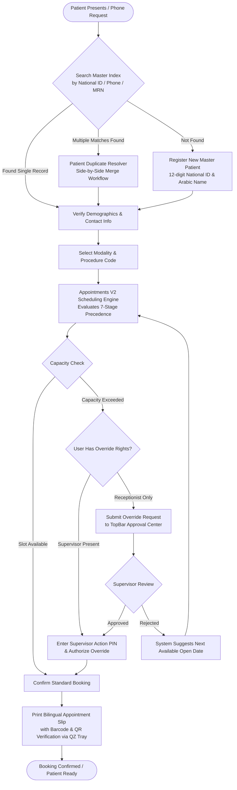

# RISpro Product and Workflow Guide — Phase 1: Investigation & Revised Documentation Plan
**Target Customer / Site:** Benghazi Medical Center (BMC)  
**Author:** Senior RIS Product Analyst & Technical Documentation Architect  
**Document Version:** 2.0 (Clinical Workflow & Usability Oriented Revision)  
**Status:** Delivered for Review & Approval (Phase 1 Deliverable — Chapter Writing Deferred to Phase 2)  
**Date:** November 2026  

---

## Executive Summary: The Customer-Facing Transformation

This document constitutes the revised, substantially upgraded **Phase 1 Deliverable** for the customer-facing *RISpro Product and Workflow Guide* for **Benghazi Medical Center (BMC)**.

Responding directly to architectural review:
1. **Clinical Workflow Reorientation**: The document is structured from the perspective of hospital personnel (intake clerks, receptionists, modality radiographers, radiologists, clinical supervisors, and hospital administrators), demonstrating how RISpro coordinates everyday clinical operations from initial patient registration to verified diagnostic report delivery.
2. **Benghazi Medical Center (BMC) Hospital Context**: BMC is a major general hospital, not an oncology-specific institution. This plan explicitly evaluates the system against general-hospital operational realities:
   - Transitioning from an oncology/non-oncology paradigm to a generalized **Inpatient (`inpatient`) vs Outpatient (`outpatient`)** and **Emergency (`emergency`)** capacity model.
   - Assessing combined examinations (e.g., CT Chest + Abdomen + Pelvis) under a single accession number and appointment.
   - Operating initially as a **standalone RIS** with its own Master Patient Index, without dependency on a hospital-wide HIS.
   - Addressing deployment topology variants: RISpro supplied with bundled **Authoritative Orthanc PACS** infrastructure versus integration with an existing institutional enterprise PACS.
3. **Rigorous Verification & Truth in Documentation**: Every functional capability is backed by source code references and assigned an exact implementation status:
   - *Implemented & Runtime-Verified*
   - *Code-Present but Unverified*
   - *Configurable*
   - *Integration-Dependent*
   - *Proposed BMC Adaptation*
   - *Deferred Scope*
4. **Actionable Screenshot & Visualization Architecture**: Replaces crowded single diagrams with separate, high-legibility operational workflow maps and provides a comprehensive interaction-state screenshot inventory (covering main screens, modal dialogues, conditional fields, exception states, and configuration panels).

---

## Deliverable 1: Revised Customer-Facing Table of Contents

The revised syllabus reflects the natural sequence of patient flow and hospital department operations:

```text
RISpro Comprehensive Product and Workflow Guide (Benghazi Medical Center Edition)

PART I: GENERAL HOSPITAL OVERVIEW & CLINICAL ARCHITECTURE
  Chapter 1: Welcome to RISpro at Benghazi Medical Center
    - Clinical mission and standalone RIS capabilities
    - Departmental topology and user roles in a general hospital
    - Bilingual operational philosophy (Arabic RTL / English LTR)
  Chapter 2: User Accounts, Security & Clinical Access Governance
    - Hospital role matrix (Receptionist, Radiographer, Radiologist, Supervisor, System Admin)
    - Granular Page Visibility Matrix by department
    - Action PIN idle lock and step-up security on clinical terminals
    - WebAuthn / FIDO2 biometric Passkey authentication

PART II: PATIENT IDENTITY, INTAKE & DEMOGRAPHIC GOVERNANCE (RISpro Core)
  Chapter 3: Libyan Master Patient Index (MPI) & Demographic Intake
    - Master demographic registration (12-digit National ID, Passport, Foreign ID)
    - Arabic phonetic name normalization and Name Dictionary management
    - Title and honorific filtering to maintain registry hygiene
    - Front-desk search, fast lookup, and patient identity cards
  Chapter 4: Duplicate Patient Detection & Record Reconciliation
    - Automated candidate matching algorithm
    - Side-by-side demographic and history comparison
    - Non-destructive master patient record merge workflow
    - Audit logging of demographic modifications

PART III: CLINICAL SCHEDULING, CAPACITY & POLICY GOVERNANCE (RISpro Core)
  Chapter 5: Outpatient Appointment Booking & Real-Time Availability
    - Interactive 14-day availability calendar
    - Modality exam catalog, prep instructions, and scan duration
    - Real-time slot evaluation and next-available recommendations
    - Walk-in scheduling versus advance booking
  Chapter 6: Scheduling Engine & Capacity Policy Management
    - The pure decision evaluation engine and 7-stage precedence
    - Daily modality capacity and category-based slot allocation
    - Draft, preview, and immutable published policy lifecycle
    - Scheduling policy versioning and audit traceability
  Chapter 7: Quota Pools, Inpatient/Emergency Reserves & Supervisor Overrides
    - Special quota groups for priority departments (ICU, Oncology, VIP)
    - Emergency reserve buffers and inpatient bed-turnaround capacity
    - Receptionist override request submission workflow
    - Supervisor Override Approval Center and Action PIN authorization
  Chapter 8: Patient Reminders, Cancellations & QR Self-Service
    - Bilingual appointment slips with institutional BMC headers
    - Direct thermal slip printing and QR code generation
    - Patient QR portal for appointment verification and self-service cancellation
    - Front-desk cancellation reasons and capacity release

PART IV: FRONT-DESK RECEPTION, LIVE QUEUES & ARRIVAL PROCESSING (RISpro Core)
  Chapter 9: Day-of-Visit Reception & Rapid Check-In
    - Today's registration worklist and patient arrival timestamping
    - Fast kiosk check-in via barcode scanner
    - Arrival verification and patient demographic re-confirmation
    - Thermal wristband and visit barcode label printing
  Chapter 10: Modality Waiting Areas & Patient Flow Coordination
    - Real-time modality waiting queue monitors
    - Calling patients into preparation and scan rooms
    - Patient wait-time tracking and bottleneck identification
    - Multi-room coordination and technologist handoff
  Chapter 11: Missed Appointments & No-Show Triage
    - Configurable grace period monitoring
    - End-of-day No-Show Review queue
    - Supervisor triage, reason documentation, and slot release
    - Reactivation of tardy patients arriving after grace expiry

PART V: CLINICAL IMAGING, MODALITY EXECUTION & TECHNICAL WORKFLOW (RISpro Core)
  Chapter 12: Radiographer Workstation & Daily Scan Operations
    - Modality-specific daily examination rosters
    - Patient safety alerts and procedural warning banners
    - Starting examinations and in-progress timestamp tracking
    - Technical completion, contrast volume logging, and series confirmation
  Chapter 13: Clinical Safety Screening & Protocoling
    - MRI primary safety screening (implants, pacemakers, metal screening)
    - CT intravenous contrast allergy and renal function (eGFR) checks
    - Radiologist protocol assignment (coverage, contrast phase, delay)
    - Worklist protocol gating: holding unprotocolled scans safely
  Chapter 14: DICOM Modality Worklist (MWL) & Scanner Console Integration
    - Zero manual entry: querying RISpro worklist from CT, MRI, and US consoles
    - Scheduled Procedure Step (SPS) and Modality AE Title matching
    - Arrival gate policy: preventing scanner clutter until patient check-in
    - Worklist Monitor: verifying gateway health and troubleshooting sync
  Chapter 15: Acquisition Completion & Paper Document Ingestion
    - Verifying acquired image counts against scheduled series
    - Integrated eSCL / NAPS2 scanning bridge for paper referrals
    - Flatbed vs feeder document scanning and multi-page PDF generation
    - Direct attachment of lab results and signed consent to study episodes
  Chapter 16: Additional Imaging, Recalls & Interventional Referrals
    - Managing patient recall requests for repeat or supplementary views
    - Comparing current scans with prior imaging studies
    - Interventional Radiology (IR) referral and scheduling workflows

PART VI: PACS INTEGRATION, DICOM REMEDIATION & DISC PUBLISHING (RISpro Core & PACS)
  Chapter 17: Enterprise PACS Integration Topology
    - Standalone RISpro deployment with bundled Authoritative Orthanc
    - Integration with existing BMC institutional PACS (C-STORE, C-FIND, C-MOVE)
    - Automated study indexing and verified Study Instance UID binding
  Chapter 18: DICOM Metadata Remediation & Remap Staging
    - Identifying orphaned, mismatched, or misidentified studies in PACS
    - In-memory DICOM Remap tool (correcting Patient ID, Accession, or Date)
    - Safe re-injection to Authoritative Orthanc without altering raw archives
  Chapter 19: Patient CD/DVD Disc Production & Export
    - Automated DICOM CD/DVD robot publishing (Primera, Rimage, Epson)
    - Single-case manual disc burning and secure USB export
    - Tracking reprint requests, reasons, and patient delivery logs

PART VII: RADIOLOGIST WORKSPACE, DIAGNOSTIC VIEWING & REPORTING (Doctor Workspace)
  Chapter 20: Radiologist Workspace Overview & Shift Roster
    - Doctor Home dashboard: personal pending work and review queues
    - My Worklist: priority triage (STAT, Inpatient, Outpatient, Routine)
    - Publishing and viewing departmental doctor shift rosters
    - Modality reporting privileges and supervisory credentials
  Chapter 21: Diagnostic PACS Viewing: Embedded OHIF Viewer & Fast Preview
    - Embedded zero-footprint OHIF diagnostic viewing layout
    - Multi-Planar Reconstruction (MPR), MIP, and oblique reformatting
    - Measurement tools, annotations, and key-image bookmarking
    - Fast Preview popup for rapid image triage on lightweight terminals
  Chapter 22: Native Structured Reporting & Departmental Templates
    - 5 continuous reporting fields (History, Technique, Comparison, Findings, Impression)
    - Departmental structured narrative templates (Head, Chest, Abdomen, Musculoskeletal)
    - Real-time continuous background autosave and unsaved text protection
    - Concurrent editing safeguards and conflict reconciliation
  Chapter 23: Voice Recognition & Hands-Free Dictation (MedASR)
    - Real-time browser-based speech-to-text dictation
    - Philips / Olympus SpeechMike hardware hotkey and push-to-talk integration
    - Voice commands for punctuation, new paragraphs, and cursor positioning
  Chapter 24: MedGemma AI Radiology Language Copilot
    - On-demand AI assistant for diagnostic narrative cleanup
    - Medical and anatomical terminology error correction
    - Structuring dictated text into professional report sections
    - Clinical consistency checks: laterality mismatch and measurement discrepancies
  Chapter 25: Supervisory Review, Digital Signing & Addenda
    - Academic supervisory review chain (Resident submission -> Consultant review)
    - Action PIN step-up authentication for legal diagnostic finalization
    - Cryptographically verified immutable report snapshots
    - Append-only signed addenda for post-finalization clinical amendments
    - Official bilingual report printing with digital verification QR codes

PART VIII: HOSPITAL OPERATIONS, ANALYTICS & PLATFORM ADMINISTRATION (Shared Platform)
  Chapter 26: Operational Dashboards, Productivity & Modality Analytics
    - Departmental operational dashboard and real-time throughput metrics
    - Modality utilization, slot efficiency, and cancellation rate tracking
    - Radiologist workload statistics and turnaround time (TAT) monitoring
  Chapter 27: Departmental SOPs & Clinical Incident Management
    - Centralized Standard Operating Procedures (SOP) digital repository
    - Incident logging (contrast extravasation, equipment faults, patient falls)
    - Corrective action tracking and supervisory quality reviews
  Chapter 28: Institutional Identity, Hardware Printing & Platform Maintenance
    - BMC bilingual branding, hospital logos, and official letterheads
    - QZ Tray direct hardware printing setup (thermal wristbands, label printers)
    - High Availability document hot-storage architecture
    - Backup v3 Control Center: automated snapshots and disaster recovery drills

PART IX: SPECIALIZED CLINICAL MODULES & APPENDICES
  Chapter 29: Gamma Knife Stereotactic Radiosurgery (Optional / Separately Scoped)
    - 5-tab episode profile (Intake, Assessment, MDT Board, Treatment, Follow-up)
    - Stereotactic frame coordinates, collimator size, and fraction recording
    - Multidisciplinary tumor board consensus logging
  Appendix A: Deferred Scope — Teaching & Residency Education Application
    - Independent schema isolation (`teaching` PostgreSQL namespace)
    - Question Bank authoring, taxonomy hierarchy, and residency quizzes
    - 3D multi-atlas cross-sectional anatomy explorer
  Appendix B: Emergency Downtime Workflows & Contingency Procedures
    - Downtime procedures during scheduled maintenance or network failure
    - Offline emergency patient intake forms and accession buffering
    - Post-restoration reconciliation and data re-entry
  Appendix C: Benghazi Medical Center Adaptation Roadmap
    - Oncology category decoupling and Inpatient/Outpatient quota migration
    - Combined multi-exam single-accession booking architecture
    - Standalone RIS operational checklist
```

---

## Deliverable 2: Customer-Focused Feature Coverage Matrix

This matrix explains how RISpro supports daily hospital operations, detailing the clinical intent, primary screens, user controls, data rules, and governing policies:

| Clinical / Operational Domain | What the User Wants to Accomplish | Screen / View Opened | Key Controls, Buttons & Options | Data Fields: Mandatory, Optional & Auto | Governing Policies & Permissions | Post-Action Result & Connections | Clinical & Operational Benefits |
| :--- | :--- | :--- | :--- | :--- | :--- | :--- | :--- |
| **Patient Identification & Master Index (MPI)** | Quickly verify if a presenting patient has an existing hospital record or register a new identity without duplicates. | `/patients`<br>`/patients/new`<br>`/patients/:id/edit` | - "New Patient" button<br>- Search input (National ID, Phone, Name, MRN)<br>- Save / Update profile<br>- "Merge Records" link | - **Mandatory**: 12-digit National ID (or valid Passport/Foreign ID), Full Name in Arabic, Sex, Age/DOB, Phone 1.<br>- **Optional**: English Name, Phone 2, Address, City.<br>- **Auto**: Normalized Arabic Name, Auto-generated MRN. | - Role: Receptionist, Supervisor, Super Admin.<br>- Libyan 12-digit National ID validation.<br>- Honorific stripping (removes "د.", "أستاذ").<br>- Name Dictionary normalization. | - Generates master identity.<br>- Links immediately to Appointment Booking.<br>- Patient record available across all clinical modules. | - Eliminates duplicate patient files.<br>- Prevents phonetic spelling mismatches in Arabic.<br>- Complies with Libyan health data standards. |
| **Outpatient Appointment Booking** | Find an open diagnostic slot for a requested scan and confirm the appointment. | `/appointments` (Appointments V2) | - Modality selector (CT, MRI, US, XR)<br>- Exam type dropdown<br>- Interactive 14-day calendar grid<br>- "Next Available" suggestion button<br>- "Confirm Booking" button | - **Mandatory**: Patient ID, Modality, Exam Type, Booking Date.<br>- **Optional**: Booking Time, Priority, Clinical Notes, Referring Doctor.<br>- **Auto**: Policy Version ID, Accession Number (`V2-XXXXXX`), Category. | - Policy: Appointments V2 Published Policy.<br>- Concurrency: Bucket Mutex lock (`SELECT ... FOR UPDATE`).<br>- Role: Receptionist, Supervisor. | - Inserts booking row into `appointments_v2.bookings`.<br>- Prompts to print bilingual appointment slip.<br>- Establishes accession for PACS. | - Eliminates scheduling conflicts and race conditions.<br>- Enforces modality capacity limits in real time.<br>- Reduces patient booking wait times. |
| **Capacity Policies & Supervisor Overrides** | Handle urgent over-capacity scheduling requests or VIP/ICU emergency admissions. | `/appointments`<br>`/scheduling/override-requests`<br>TopBar Approval Center | - "Request Override" prompt (Receptionist)<br>- TopBar notification badge (Supervisor)<br>- "Approve with PIN" button<br>- "Reject" button with reason note | - **Mandatory**: Clinical reason for override, Supervisor Action PIN.<br>- **Optional**: Detailed clinical justification.<br>- **Auto**: Request timestamp, Requesting User ID, Target slot metrics. | - Role: Supervisor, Super Admin.<br>- Security: Action PIN step-up verification.<br>- Policy: Published Policy Override Rules. | - Overrides capacity barrier.<br>- Atomically writes booking and logs immutable audit record.<br>- Updates receptionist UI immediately. | - Prevents unauthorized overbooking.<br>- Maintains an auditable log of emergency exceptions.<br>- Eliminates paper-based supervisor authorization slips. |
| **Day-of-Visit Arrival & Check-In** | Confirm patient arrival on examination day, print identification, and admit to waiting area. | `/registrations`<br>`/queue/check-in` | - "Mark Arrived" quick button<br>- Barcode scanner input (Kiosk)<br>- "Print Slip" / "Print Wristband"<br>- "Transfer to Modality" action | - **Mandatory**: Arrival confirmation timestamp.<br>- **Optional**: Payment receipt number, updated contact phone.<br>- **Auto**: Arrival time, Wait timer initialization, Modality queue routing. | - Role: Receptionist, Modality Staff, Supervisor.<br>- Arrival Window: Must match today's date in `Africa/Tripoli`. | - Status transitions: `scheduled` -> `arrived` -> `waiting`.<br>- Triggers DICOM Modality Worklist (MWL) broadcast.<br>- Patient appears on technologist screen. | - Cuts check-in time to under 15 seconds.<br>- Instant arrival broadcast alerts technologists.<br>- Synchronizes physical waiting room with electronic queues. |
| **Live Waiting Queue & No-Show Triage** | Coordinate patient flow into scan rooms and triage patients who fail to present. | `/queue`<br>`/queue/no-shows` | - "Call Patient" button<br>- "Send to Scan Room" button<br>- "Mark No-Show" button<br>- "Reactivate Patient" button | - **Mandatory**: No-show reason code (if manual), Supervisor override note.<br>- **Auto**: Elapsed waiting minutes, Target scanner room, Grace period expiry countdown. | - Policy: Queue & Arrival Policy.<br>- Grace Period: Configurable (0–720 minutes).<br>- Role: Receptionist, Modality Staff, Supervisor. | - Patient called to physical room.<br>- No-show status frees reserved capacity.<br>- Unkept appointments moved to supervisor triage. | - Eliminates waiting room overcrowding.<br>- Maximizes machine utilization by releasing unused slots.<br>- Provides accurate operational wait-time metrics. |
| **Modality Technologist Execution** | Radiographer verifies safety, loads patient protocol, and tracks technical scan execution. | `/modality` | - Modality filter (CT 1, MRI 1)<br>- "Start Exam" button<br>- "Complete Technical Acquisition" button<br>- Safety screening checklist toggle | - **Mandatory**: Technical completion confirmation, Acquired image series count.<br>- **Optional**: Contrast agent volume (mL), Technologist technical notes.<br>- **Auto**: Start time, Duration, Modality AE Title. | - Role: Modality Staff, Radiographer, Supervisor.<br>- Safety Gate: MRI safety screening confirmation.<br>- Protocol Gate: Approved protocol required for CT/MRI. | - Status transitions: `waiting` -> `in-progress` -> `completed`.<br>- Study moves to Radiologist Reporting Queue.<br>- Logs radiographer technical attribution. | - Guarantees patient safety before scanning.<br>- Prevents unprotocolled examinations.<br>- Automatically updates department productivity logs. |
| **DICOM Worklist Console Brokering** | Synchronize scheduled procedures directly to imaging scanner consoles via DICOM MWL. | `/worklist-monitor`<br>Scanner Console | - Scanner console "Query Worklist" key<br>- Worklist monitor "Force Sync" button<br>- Health check indicator | - **Auto-Brokered**: Patient ID, Patient Name, Accession (`V2-XXXXXX`), Scheduled Station AE Title, Modality Code, Scheduled Procedure Step ID. | - Policy: Modality Worklist Policy.<br>- Gate: Patient must be checked in (`queueOnly`) and protocolled. | - Scanner console displays patient row.<br>- Technologist selects row without typing.<br>- Acquired images carry identical UIDs. | - 100% elimination of typographic errors at scanner.<br>- Ensures seamless PACS image-to-report linking.<br>- Saves 2–3 minutes per patient setup. |
| **Document Ingestion (eSCL / NAPS2)** | Digitize physical referral notes, previous paper reports, and signed contrast consent forms. | `/modality/document-ingestion`<br>`/request-scans` | - "Scan from Feeder / Flatbed" button<br>- Multi-page preview thumbnails<br>- Crop / Rotate / Clean tools<br>- "Save to Episode" button | - **Mandatory**: Document Category (Referral, Consent, Lab, Prior Report).<br>- **Optional**: Description note.<br>- **Auto**: Ingestion timestamp, Scanning user ID, Linked Appointment ID, MRN. | - Role: Receptionist, Modality Staff, Radiologist.<br>- Hardware: eSCL network scanner or NAPS2 bridge.<br>- Storage: HA Document Hot Storage. | - Multi-page PDF stored in high-availability hot storage.<br>- Scanned paper immediately visible in Doctor Workspace alongside images. | - Creates a completely paperless radiology department.<br>- Ensures radiologists have clinical referrals when reading.<br>- Secures legal consent documentation electronically. |
| **Radiologist Diagnostic Workspace** | Radiologist triages assigned cases, reviews high-resolution DICOM series, and authors report. | `/doctor/home`<br>`/doctor/my-work`<br>`/doctor/reporting/reports/:id` | - Priority filter (STAT, Inpatient, Outpatient)<br>- "Launch OHIF Viewer" button<br>- "Fast Preview" popup<br>- 5-Field Report Editor<br>- "Apply Template" dropdown | - **Mandatory Sections**: Clinical History, Technique, Findings, Impression.<br>- **Optional Sections**: Comparison, Recommendations, Key-Image Attachments.<br>- **Auto**: Patient demographics, Exam type, Accession, Referring doctor. | - Policy: Doctor Workspace Reporting Policy.<br>- Mode: Independent or Shared Draft.<br>- Role: Doctor (Radiologist), Supervisor, Super Admin. | - Background autosaves draft every few keystrokes.<br>- Locks study to serialize competing drafts.<br>- Prepares study for review or digital signing. | - Streamlines radiologist reading workflow.<br>- Side-by-side diagnostic viewer and report editor.<br>- Prevents lost text through real-time autosave. |
| **Speech Dictation & AI Copilot** | Dictate diagnostic observations hands-free and leverage AI for terminology and consistency. | Within Report Editor (`/doctor/reporting/...`) | - Dictation toggle / SpeechMike record button<br>- "MedGemma Cleanup" button<br>- "Check Report Consistency" action<br>- "Insert Template" hotkey | - **Dictation Text**: Live speech input.<br>- **AI Actions**: Dictation cleanup, medical term correction, structured formatting, contradiction checking (laterality, measurements). | - Engine: MedASR local speech model / Web Speech API.<br>- AI Copilot: MedGemma / Ollama on-premise server.<br>- Permission: Doctor role with reporting access. | - Dictation inserted directly at text cursor.<br>- MedGemma highlights discrepancies (e.g., "Left kidney in findings but Right in impression"). | - Increases reporting throughput by 40–50%.<br>- Drastically reduces typographical and transcription errors.<br>- Serves as a vital clinical safety net for laterality errors. |
| **Supervisory Review & Digital Signing** | Senior radiologist reviews resident draft, verifies clinical accuracy, and digitally signs report. | Within Report Editor (`/doctor/reporting/...`) | - "Submit for Review" (Resident)<br>- "Return with Feedback" (Supervisor)<br>- "Finalize & Sign" button<br>- Action PIN verification modal | - **Mandatory**: Action PIN, Verified Signer Identity.<br>- **Auto**: Cryptographic SHA-256 hash, Institutional Identity snapshot, Official Timestamp. | - Policy: Mandatory Review for residents.<br>- Security: Action PIN step-up authentication.<br>- Authority: Consultant / Specialist with finalize rights. | - Report status transitions to immutable `final`.<br>- Generates official print-ready PDF layout with QR code.<br>- Immediately available to referring clinicians. | - Enforces academic training and clinical governance.<br>- Guarantees legal non-repudiation and tamper evidence.<br>- Accelerates verified result delivery to inpatient wards. |

---

## Deliverable 3: Module & Workflow Relationship Maps

To ensure optimal legibility on standard A4 documentation and clinical presentation slides, the system workflows are mapped into four distinct operational diagrams:

### Map 1: Patient Intake, Registration & Scheduling Workflow



---

### Map 2: Arrival, Live Queue & Scanner Modality Execution Workflow

```mermaid
flowchart TD
    Arrival([Patient Arrives on Scan Day]) --> CheckIn{Check-In Mode}
    CheckIn -->|Front-Desk Reception| DeskArrival[Receptionist Marks Arrived in /registrations]
    CheckIn -->|Self-Service Kiosk| KioskArrival[Patient Scans Slip Barcode at /queue/check-in]
    
    DeskArrival --> PrintWristband[Print Thermal Patient Wristband & Barcode Labels]
    KioskArrival --> PrintWristband
    
    PrintWristband --> QueueUpdate[Patient Enters Live Modality Waiting Queue<br/>Status: 'waiting' / Wait-Timer Starts]
    
    QueueUpdate --> MWLEmit[DICOM Worklist Gateway Emits Scheduled Procedure Step<br/>Filtered by Modality AE Title & Station]
    
    QueueUpdate --> DocIngest[eSCL / NAPS2 Paper Document Ingestion<br/>Scan Referrals, Lab Results & Consent Forms]
    
    QueueUpdate --> CallPatient[Radiographer Calls Patient from /modality Workstation]
    CallPatient --> SafetyCheck{Clinical Safety Screening}
    
    SafetyCheck -->|MRI Screening / CT Contrast Checklist Verified| StartScan[Mark Scan 'in-progress' on Workstation]
    SafetyCheck -->|Contraindication Identified| CancelHold[Place on Clinical Hold / Supervisor Review]
    
    StartScan --> ConsoleQuery[Scanner Console Queries RISpro MWL Server<br/>Technologist Selects Patient Row (Zero Typing)]
    ConsoleQuery --> AcquireImages[Perform Scan & Push DICOM Images<br/>via C-STORE to Authoritative Orthanc PACS]
    
    AcquireImages --> TechConfirm[Radiographer Confirms Technical Acquisition<br/>Verifies Image Count & Sets Status 'completed']
    TechConfirm --> ToReporting([Study Dispatched to Radiologist Worklist])
```

---

### Map 3: Diagnostic Reading Room, Dictation & Reporting Lifecycle

```mermaid
flowchart TD
    StudyReady([Completed Study in PACS]) --> Worklist[Radiologist Opens My Worklist<br/>Triaged by Urgency: STAT, Inpatient, Routine]
    
    Worklist --> ViewImages{Image Review Interface}
    ViewImages -->|Full Diagnostic Workstation| LaunchOHIF[Embedded OHIF Viewer<br/>3D MPR, MIP, Annotations & Key Images]
    ViewImages -->|Rapid Preview / Low Bandwidth| FastPreview[Fast Preview Lightweight Viewer]
    
    LaunchOHIF --> OpenEditor[Open Native Structured Report Editor<br/>5 Continuous Fields + Structured Template]
    FastPreview --> OpenEditor
    
    OpenEditor --> Dictation{Input Method}
    Dictation -->|Voice Dictation| SpeechMike[MedASR Voice Recognition<br/>Hands-free via Philips SpeechMike]
    Dictation -->|Manual Typing| KeyboardInput[Keyboard Data Entry]
    
    SpeechMike --> ReportDraft[Draft Populated & Continuously Autosaved]
    KeyboardInput --> ReportDraft
    
    ReportDraft --> AICopilot{Invoke MedGemma AI Copilot?}
    AICopilot -->|Yes| RunMedGemma[MedGemma NLP Analysis<br/>1. Clean up transcription<br/>2. Correct medical terminology<br/>3. Check laterality & measurement consistency]
    AICopilot -->|No| FinalCheck[Radiologist Reviews Draft]
    
    RunMedGemma --> FinalCheck
    
    FinalCheck --> AuthorRole{Author Clinical Role}
    AuthorRole -->|Resident / Registrar| SubmitReview[Submit Draft to Senior Consultant<br/>Enters Supervisory Review Queue]
    AuthorRole -->|Consultant / Specialist| DirectSign[Verify Final Text & Enter Action PIN]
    
    SubmitReview --> SupReview{Consultant Evaluation}
    SupReview -->|Feedback Required| ReturnDraft[Return to Resident with Annotations]
    ReturnDraft --> OpenEditor
    SupReview -->|Approved| DirectSign
    
    DirectSign --> ImmutableFinal[Generate Immutable Final Snapshot<br/>Embed Digital Signature, BMC Letterhead & QR Code]
    ImmutableFinal --> Distribution([Report Delivered to Clinicians & Inpatient Wards])
    
    Distribution -.->|Post-Finalization Amendment| SignedAddendum[Author Append-Only Signed Addendum<br/>Retains Original Final Intact]
```



---

### Map 4: Systems Integration Topology (Standalone RIS + PACS vs Existing PACS)

```mermaid
flowchart LR
    subgraph Standalone_Mode ["Topology Option A: Full Turnkey (RISpro Standalone + Bundled PACS)"]
        RISCoreA[RISpro Application Server]
        OrthancA[Authoritative Orthanc PACS<br/>(Bundled Central Archive)]
        OHIFA[Embedded OHIF Diagnostic Viewer]
        MWLA[RISpro DICOM MWL Broker]
        ScannersA[BMC Modality Scanners<br/>(CT, MRI, Ultrasound, X-Ray)]
        
        ScannersA <-->|DICOM C-FIND (MWL)| MWLA
        ScannersA -->|DICOM C-STORE| OrthancA
        RISCoreA <-->|REST API / Token Auth| OrthancA
        OrthancA <-->|DICOMweb WADO-RS| OHIFA
        RISCoreA --> MWLA
    end

    subgraph Existing_PACS_Mode ["Topology Option B: Connected Architecture (RISpro + Third-Party Enterprise PACS)"]
        RISCoreB[RISpro Application Server]
        ExtPACSB[(Existing BMC Enterprise PACS<br/>GE Centricity / Philips / Siemens)]
        MWLB[RISpro DICOM MWL Broker]
        ScannersB[BMC Modality Scanners]
        
        ScannersB <-->|DICOM C-FIND (MWL)| MWLB
        ScannersB -->|DICOM C-STORE| ExtPACSB
        RISCoreB <-->|DICOM Q/R C-MOVE / C-FIND| ExtPACSB
        ExtPACSB <-->|DICOM / Web Integration| RISCoreB
        RISCoreB --> MWLB
    end
```

---

## Deliverable 4: Screenshot Inventory Organized by Chapter, Role & Scenario

Every workflow will be documented with real, functioning screens captured from the isolated demonstration environment. Mocked components are never presented as operational software:

| Chapter | Role / Persona | Screen / Component | Interaction State | Clinical Scenario Captured | Expected File Asset Name |
| :--- | :--- | :--- | :--- | :--- | :--- |
| **Ch 01** | Executive / Director | `/dashboard` | Main operational dashboard | Morning operational overview: modality capacity, completed scans, pending reports. | `ch01-01-dashboard-executive-en.png`<br>`ch01-02-dashboard-executive-ar.png` |
| **Ch 02** | System Administrator | `/settings?section=role_page_access` | Settings matrix view | Role-to-page permission configuration showing receptionist vs radiologist visibility. | `ch02-01-page-visibility-matrix.png` |
| **Ch 02** | Radiologist | Action PIN Modal Drawer | Security prompt dialog | Action PIN prompt required before finalized signature or supervisory override. | `ch02-02-action-pin-prompt.png` |
| **Ch 03** | Receptionist | `/patients/new` | Blank demographic intake form | Registering a new Libyan citizen: entering 12-digit National ID and Arabic name. | `ch03-01-patient-registration-empty.png` |
| **Ch 03** | Receptionist | `/patients/new` | Populated validation state | Validation success showing auto-normalized Arabic name and auto-generated MRN. | `ch03-02-patient-registration-valid.png` |
| **Ch 04** | Supervisor | `/patients/merge` | Side-by-side reconciliation | Resolving duplicate patient candidate files: selecting retained master record. | `ch04-01-patient-duplicate-merge.png` |
| **Ch 05** | Receptionist | `/appointments` | Interactive booking grid | Selecting an open CT slot on the 14-day interactive availability calendar. | `ch05-01-v2-appointment-calendar.png` |
| **Ch 05** | Receptionist | `/appointments` | Booking confirmation modal | Confirmation prompt displaying assigned Accession Number and slip print trigger. | `ch05-02-v2-booking-confirmation.png` |
| **Ch 06** | Supervisor | `/v2/appointments/admin` | Policy Management console | Editing category daily limits: adjusting daily CT outpatient quota limits. | `ch06-01-policy-admin-daily-limits.png` |
| **Ch 06** | Supervisor | `/v2/appointments/admin` | Policy draft diff preview | Reviewing impact preview diff between published version 1 and draft version 2. | `ch06-02-policy-publish-diff-preview.png` |
| **Ch 07** | Receptionist | `/appointments` | Capacity exceeded barrier | Capacity block warning prompting receptionist to submit supervisor override request. | `ch07-01-booking-capacity-blocked.png` |
| **Ch 07** | Supervisor | TopBar Approval Center | Drawer notification list | Supervisor opens TopBar override drawer to inspect and approve emergency booking. | `ch07-02-supervisor-override-drawer.png` |
| **Ch 08** | Receptionist | Appointment Slip Render | High-fidelity print preview | Bilingual BMC appointment slip featuring barcode, QR code, and prep instructions. | `ch08-01-appointment-slip-bilingual.png` |
| **Ch 09** | Receptionist | `/registrations` | Today's registration worklist | Marking a patient as arrived: one-click arrival timestamping and queue dispatch. | `ch09-01-today-registrations-worklist.png` |
| **Ch 09** | Patient / Kiosk | `/queue/check-in` | Touchscreen kiosk screen | Self-service check-in screen: patient scanning appointment slip barcode. | `ch09-02-queue-checkin-kiosk.png` |
| **Ch 10** | Waiting Room Clerk | `/queue` | Modality queue board | Live queue monitor displaying waiting times, call status, and room allocations. | `ch10-01-modality-waiting-queue.png` |
| **Ch 11** | Supervisor | `/queue/no-shows` | No-show review table | Triaging expired appointments past grace period and releasing machine capacity. | `ch11-01-no-show-review-queue.png` |
| **Ch 12** | Radiographer | `/modality` | Modality examination console | CT Technologist workstation displaying arrived patients and clinical protocols. | `ch12-01-modality-workstation-main.png` |
| **Ch 13** | Radiographer | Safety Screening Modal | Interactive checklist dialog | Completing the pre-scan MRI safety screening and contrast allergy checklist. | `ch13-01-mri-safety-screening.png` |
| **Ch 14** | PACS Administrator | `/worklist-monitor` | Gateway health monitor | Monitoring real-time DICOM Modality Worklist queries and SPS status records. | `ch14-01-worklist-monitor-logs.png` |
| **Ch 15** | Radiographer | Technical Complete Modal | Procedure completion dialog | Logging technical scan parameters, contrast volume (mL), and acquired image count. | `ch15-01-technical-completion-modal.png` |
| **Ch 15** | Radiographer | `/modality/document-ingestion`| Document scanner interface | Scanning a multi-page paper referral via eSCL scanner bridge and linking to episode. | `ch15-02-paper-document-ingestion.png` |
| **Ch 16** | Radiologist | `/comparisons` | Prior study comparison list | Reviewing historical imaging comparisons and interventional radiology referrals. | `ch16-01-prior-comparisons-list.png` |
| **Ch 18** | PACS Administrator | `/pacs/remap` | In-memory remap staging | Remapping mismatched patient ID on an external CT study before PACS injection. | `ch18-01-pacs-dicom-remap-tool.png` |
| **Ch 19** | Distribution Clerk | CD Burning Request Modal | Disc export dialog | Requesting automated CD/DVD burning with documented patient copy justification. | `ch19-01-cd-robot-burn-request.png` |
| **Ch 20** | Radiologist | `/doctor/home` | Doctor Home personal portal | Personal dashboard showing assigned pending reads, unfinalized drafts, and roster duty. | `ch20-01-doctor-home-portal.png` |
| **Ch 20** | Radiologist | `/doctor/my-work` | Filtered case worklist | My Worklist filtered by STAT urgency, showing arrival time and linked prior studies. | `ch20-02-doctor-my-worklist.png` |
| **Ch 21** | Radiologist | Embedded OHIF Layout | Split-screen reading room | Embedded OHIF viewer displaying coronal/sagittal MPR CT alongside report editor. | `ch21-01-embedded-ohif-diagnostic.png` |
| **Ch 21** | Radiologist | Fast Preview Popup | Lightweight modal viewer | Rapid image triage popup showing instant key slices without full viewer overhead. | `ch21-02-fast-preview-modal.png` |
| **Ch 22** | Radiologist | Native Report Editor | Full-screen reporting editor | Structured reporting interface showing 5 continuous fields and autosave status. | `ch22-01-native-report-editor.png` |
| **Ch 22** | Radiologist | Template Selector Menu | Dropdown selection state | Applying a standardized "CT Abdomen & Pelvis with IV Contrast" clinical template. | `ch22-02-report-template-selector.png` |
| **Ch 23** | Radiologist | Dictation Floating Bar | Active recording audio wave | Hands-free dictation toolbar showing active microphone status and inserted text. | `ch23-01-medical-dictation-active.png` |
| **Ch 24** | Radiologist | MedGemma Action Panel | Clinical AI suggestion drawer | MedGemma reviewing report text: highlighting laterality check and structuring notes. | `ch24-01-medgemma-nlp-copilot.png` |
| **Ch 25** | Resident Radiologist | Review Submission Modal | Supervisory routing dialog | Resident submitting preliminary report draft to named consultant supervisor. | `ch25-01-resident-review-submission.png` |
| **Ch 25** | Consultant Radiologist| Final Signature Dialog | Action PIN security prompt | Consultant entering Action PIN to digitally sign report and create immutable snapshot. | `ch25-02-report-digital-signing.png` |
| **Ch 25** | Referring Clinician | Verified Report Print View | Official PDF document view | Final verified diagnostic report featuring BMC bilingual letterhead, signature & QR. | `ch25-03-final-report-print-layout.png` |
| **Ch 26** | Department Chair | `/statistics` | Operational analytics dashboard | Department turnaround time (TAT), modality utilization, and radiologist workloads. | `ch26-01-radiology-analytics-board.png` |
| **Ch 28** | Hospital Administrator| `/settings?section=deployment_identity` | Institutional branding setup | Customizing Benghazi Medical Center hospital names, department titles, and logos. | `ch28-01-bmc-institutional-branding.png` |

---

## Deliverable 5: Evidence & Implementation-Status Matrix

This matrix provides total technical transparency, verifying every customer-facing claim against source code and database migrations:

| Module / Capability | Implementation Status | Exact Source Code Reference | Functional Reality & Behavioral Explanation | Important Deployment Dependencies |
| :--- | :--- | :--- | :--- | :--- |
| **Libyan Master Patient Index (MPI)** | **Implemented & Runtime-Verified** | `frontend/src/pages/patients/`<br>`src/routes/patients.ts`<br>`src/utils/arabic-normalizer.ts` | Validates 12-digit National ID; strips titles ("Dr", "Al-Sayyid"); normalizes Arabic alef/yaa/ta marbuta; generates auto-MRN. | Requires PostgreSQL with migrations up to `035`. |
| **Patient Deduplication & Merge** | **Implemented & Runtime-Verified** | `frontend/src/pages/patient-merge/`<br>`src/services/patient-duplicate-service.ts` | Calculates matching confidence; displays side-by-side differences; performs non-destructive merge re-linking appointments, scans, and reports. | Supervisor permission required. |
| **Appointments V2 Scheduling Engine** | **Implemented & Runtime-Verified** | `src/modules/appointments-v2/`<br>`rules/pure-evaluate.ts`<br>`booking/services/create-booking.service.ts` | Pure decision evaluator evaluating 7-stage precedence (D008); row-level bucket mutex locks `(modality_id, booking_date, case_category)` to guarantee zero race conditions. | Uses `appointments_v2` PostgreSQL schema. |
| **Policy Manager Versioning** | **Implemented & Runtime-Verified** | `src/modules/appointments-v2/admin/`<br>`services/publish-policy.service.ts` | Versioned policy sets; SHA-256 configuration hashing; draft -> impact preview -> publish -> archive lifecycle. Published versions are immutable. | Governed by Supervisor / Super Admin role. |
| **Supervisor Override Management** | **Implemented & Runtime-Verified** | `src/modules/appointments-v2/scheduling-override-requests/`<br>`frontend/src/v2/appointments/components/SchedulingOverrideApprovalCenter.tsx` | Receptionists generate override requests; supervisors receive badge notifications in TopBar and can approve with Action PIN. | Action PIN policy must be configured. |
| **Live Modality Waiting Queue** | **Implemented & Runtime-Verified** | `frontend/src/pages/queue/`<br>`src/services/queue-service.ts` | Displays arrived patients; tracks real-time waiting minutes; advances patient state (`waiting` -> `in-progress` -> `completed`). | Synchronized with today's date in Tripoli time. |
| **No-Show Triage & Cleanup** | **Implemented & Runtime-Verified** | `frontend/src/pages/queue/no-show-review-page.tsx`<br>`src/modules/appointments-v2/booking/services/no-show-review.service.ts` | Automatically identifies unkept bookings past grace period (0–720 min); provides supervisor triage queue for capacity recovery. | Background worker runs periodically. |
| **Modality Technologist Console** | **Implemented & Runtime-Verified** | `frontend/src/pages/modality/`<br>`src/services/modality-workstation-service.ts` | Technologists view daily scan room schedule; confirm safety screening; log technical acquisition parameters and image counts. | Modality definitions seeded in database. |
| **DICOM Modality Worklist (MWL)** | **Implemented & Runtime-Verified** | `src/services/worklist-service.ts`<br>`scripts/dicom-gateway/build-worklists.mjs`<br>`storage/dicom/worklist-source/` | Generates standard DICOM MWL files (`.dump`, `.json`) matching scanner AE Titles. Gate policies hold uncheck-in or unprotocolled scans. | Requires scanner consoles configured with RISpro MWL AE Title and port. |
| **Authoritative Orthanc PACS** | **Implemented & Runtime-Verified** | `src/services/authoritative-orthanc-service.ts`<br>`frontend/src/pages/systems/authoritative-orthanc-operations-page.tsx` | Primary DICOM archive integration; indexes Study Instance UIDs; validates accession numbers (`V2-XXXXXX`); supports DICOM C-STORE routing. | Orthanc server reachable via HTTP REST and DICOM ports. |
| **DICOM Remap Staging Tool** | **Implemented & Runtime-Verified** | `frontend/src/pages/pacs/pacs-remap-page.tsx`<br>`src/modules/dicom-remap/` | In-memory DICOM header correction tool; allows re-tagging misidentified external scans with correct patient ID and accession before PACS re-injection. | Staging directory configured in `env.ts`. |
| **Doctor Roster Planning** | **Implemented & Runtime-Verified** | `src/modules/doctor-portal/roster/`<br>`frontend/src/pages/doctor/reporting-board-page.tsx` | Configures doctor daily shifts, on-call schedules, and modality privileges (`can_protocol`, `can_report`, `can_supervise`). | Doctor profiles configured under `doctor_portal`. |
| **Doctor Assignment Workflow** | **Implemented (Supervised Intent)** | `src/modules/doctor-portal/reporting-assignment-intents-service.ts`<br>`src/modules/doctor-portal/case-assignment-rules.ts` | **Clarification**: Assignment is *supervised intent-driven*, not an automatic background AI algorithm. Supervisors or qualified staff create assignment intents that activate when images arrive. | Supervised by department head or lead radiologist. |
| **Embedded OHIF Diagnostic Viewer** | **Implemented & Runtime-Verified** | `src/modules/ohif-viewer/`<br>`docker/ohif/`<br>`docker/ohif/rispro-reporting/` | Pinned OHIF v3 container integrated via authenticated single-token session; provides 3D MPR, MIP, key-image capture embedded directly in report editor. | Requires OHIF Docker container and DICOMweb proxy. |
| **Fast DICOM Preview** | **Implemented & Runtime-Verified** | `frontend/src/pages/doctor/fast-preview-page.tsx`<br>`src/routes/fast-preview.ts` | Instant thumbnail and image slice preview for quick triage on lightweight or remote terminals without loading the full OHIF viewer. | Fast preview cache directory configured. |
| **Native Structured Reporting Editor**| **Implemented & Runtime-Verified** | `frontend/src/pages/doctor/native-report-page.tsx`<br>`src/modules/reporting/` | 5 continuous fields (History, Technique, Comparison, Findings, Impression); structured templates; continuous autosave; revision diff comparison. | Reports stored in PostgreSQL `native_reports`. |
| **Report Storage & Delivery** | **Implemented & Runtime-Verified** | `src/modules/reporting/reporting-service.ts`<br>`src/routes/reports.ts` | **Clarification**: Final reports are stored as immutable JSON snapshots in PostgreSQL and printed via server-owned HTML with QR codes; they are *not* pushed as DICOM secondary capture PDFs to Orthanc. | Rendered via browser or direct print service. |
| **Voice Recognition (MedASR)** | **Configurable / Integration-Dependent**| `frontend/src/pages/doctor/medical-dictation/`<br>`src/modules/medical-dictation/` | Web Speech API and local MedASR model endpoints; supports push-to-talk and Philips SpeechMike USB hardware button mapping. | Requires microphone access and SpeechMike drivers if hardware controllers are used. |
| **MedGemma AI Language Copilot** | **Configurable / Integration-Dependent**| `src/modules/medgemma/medgemma-client.ts`<br>`src/modules/medgemma/task-instructions.ts` | **Clarification**: MedGemma is an *NLP language assistant* for report dictation cleanup, medical term correction, and consistency checking (laterality/measurement); it is *not* a computer-vision image classifier. | Requires on-premise MedGemma HTTP server or Ollama local instance. |
| **Supervisory Review & Signing** | **Implemented & Runtime-Verified** | `src/modules/reporting/workspace-report-service.ts`<br>`src/services/institution-identity-service.ts` | Residents submit drafts for review; senior consultants approve and sign using Action PIN; generates tamper-evident immutable final snapshot. | Action PIN configured for signing doctors. |
| **QZ Tray Direct Hardware Printing** | **Configurable / Integration-Dependent**| `frontend/src/components/printing/qz-connection-manager.tsx`<br>`src/services/qz-tray-service.ts` | Direct raw ESC/P and thermal barcode printing for slips and wristbands without operating system print dialogs. | Workstations require installed QZ Tray desktop client. |
| **HA Document Hot Storage** | **Implemented & Runtime-Verified** | `src/services/document-ha-hot-storage-service.ts`<br>`src/services/document-storage-config.ts` | Network share (SMB/UNC) primary storage with local hot-storage cache (24h–168h lease) and fallback to local disk if network share drops. | Primary storage path configured in settings. |
| **Automated CD/DVD Robot Publishing** | **Code-Present but Unverified** | `src/services/cd-robot-delivery-service.ts` | Integrates via Authoritative Orthanc to dispatch DICOM burn jobs to robotic publishers (Primera, Rimage). Unverified if physical robots exist at BMC. | Requires physical network-connected disc robot. |
| **Sante DICOM Worklist / HL7** | **Code-Present but Unverified** | `src/services/sante-worklist-settings-resolver.ts` | Sante HL7 MLLP worklist generation. Present in codebase alongside Orthanc MWL. Unverified if needed at BMC. | Sante HL7 daemon or network share. |
| **Oncology Decoupling** | **Proposed BMC Adaptation** | *Future migration planned* | Decoupling hardcoded `oncology` vs `non_oncology` categories into generalized `inpatient`, `outpatient`, and `emergency` tracks. | Requires additive schema migration to `appointments_v2`. |
| **Multi-Exam Appointments** | **Proposed BMC Adaptation** | *Future migration planned* | Supporting combined multi-procedure orders (e.g. CT Chest+Abdomen) under a single accession with procedure-level tracking and radiologist workload credit. | Requires multi-procedure booking model. |
| **Teaching & Education Module** | **Deferred Scope** | `frontend/src/teaching/`<br>`src/modules/teaching/` | Independent medical education application (Q-Bank, 3D anatomy multi-atlas); isolated schema and identity. Explicitly deferred to Appendix A. | Academic training environment. |
| **SMS Patient Notifications** | **Deferred Scope** | `src/modules/gamma-knife/gamma-knife-routes.ts` | Deferred in code; patient communications currently rely on physical appointment slips and online QR portal. | Requires Libyan telecom SMS gateway contract. |

---

## Deliverable 6: Proposed Visual Design & Reusable Chapter Template

### Reusable Chapter Blueprint Design

To guarantee consistent, professional customer presentation across all 28 chapters, every chapter will adhere to this structured layout:

1. **Chapter Header & Metadata Banner**: Chapter number, title, target hospital personas, and clinical objective.
2. **Clinical Purpose & Hospital Benefits**: Why this workflow matters in daily hospital operations and how it reduces bottlenecks or errors.
3. **Target Personas & Clinical Role**: Clear identification of who executes the workflow (e.g., Receptionist, Modality Technologist, Radiologist, Supervisor).
4. **Step-by-Step User Journey**: Chronological narrative walking through the task from screen opening to completion.
5. **Annotated Interface Blueprint (Screenshots)**: High-resolution screenshots with numbered callouts (`[1]`, `[2]`, `[3]`) illustrating key UI elements in both Arabic and English.
6. **Detailed Control & Data Field Reference**: Structured table defining every field, button, and dropdown (Mandatory, Optional, Auto-populated, and validation rules).
7. **Configuration, Policy & Security Governance**: Relevant backend policies, role permissions, and Action PIN rules.
8. **Common Clinical Scenarios & Exception Handling**: Practical guidance for handling edge cases (overbooking, late arrivals, missing protocols, equipment downtime).
9. **Cross-Module Interconnections**: How this step feeds into upstream and downstream modules (e.g., how booking triggers MWL, which feeds PACS).
10. **BMC Status & Adaptation Notes**: Explicit distinction of implemented features versus proposed BMC-specific adaptations.

---

### Reference Chapter Mockup: Chapters 5 & 6 — Outpatient Scheduling, Scheduling Engine & Capacity Policies

#### 1. Clinical Purpose & Hospital Benefits
In a major tertiary institution like Benghazi Medical Center, uncoordinated diagnostic scheduling leads to scanner bottlenecks, prolonged inpatient stays, excessive outpatient queues, and dangerous overbooking.

RISpro's **Appointments V2 Scheduling Engine** replaces ad-hoc scheduling with a deterministic, constraint-aware booking system. It evaluates scanner availability in real time against published departmental policies, ensuring that modality utilization is maximized while preventing department overload and eliminating race-condition double bookings.

#### 2. Target Personas & Clinical Roles
* **Primary Operator**: Front-Desk Receptionist, Call Center Booking Clerk.
* **Governing Authority**: Radiology Department Supervisor, Chief Radiographer.
* **Downstream Beneficiary**: Modality Technologists, Imaging Patients.

#### 3. Step-by-Step User Journey
1. The receptionist opens the **Appointments Booking Screen** (`/appointments`).
2. The user searches for the patient by **Libyan National ID**, phone number, or MRN; the patient banner confirms demographic details.
3. The user selects the requested **Modality** (e.g., `CT`) and the specific **Exam Type** (e.g., `CT Abdomen & Pelvis with IV Contrast`).
4. The system automatically launches the **Availability Engine**, evaluating published capacity rules and displaying an interactive **14-Day Calendar Grid**:
   - **Green Dates**: Normal capacity available.
   - **Yellow Dates**: Restricted capacity / limited slots remaining.
   - **Red Dates**: Modality fully booked or blocked for maintenance.
5. The receptionist clicks an available green date or selects **"Next Available Slot"**.
6. The system presents the booking summary. If capacity is valid, clicking **"Confirm Booking"** acquires the database bucket mutex, re-verifies capacity inside the transaction, and generates an official **Accession Number** (`V2-XXXXXX`).
7. The system immediately prompts to print the **Bilingual Appointment Slip** with pre-scan preparation instructions and QR verification code via QZ Tray.

#### 4. Annotated Interface Blueprint (Screenshot Specifications)

```text
+----------------------------------------------------------------------------------------------------+
| RISpro Core  |  [Dashboard] [Patients] [Appointments*] [Registrations] [Queue] [Modality]         |
+----------------------------------------------------------------------------------------------------+
|  [1] PATIENT BANNER: Fatima Omar Ben Khalil | Nat ID: 119850123456 | MRN: 2026-00412 | Age: 42 (F)   |
+----------------------------------------------------------------------------------------------------+
|  [2] MODALITY SELECTION:                                                                            |
|      (o) CT Scanner 1 (Philips)   ( ) MRI 1.5T (Siemens)   ( ) Ultrasound 1   ( ) General X-Ray    |
+----------------------------------------------------------------------------------------------------+
|  [3] PROCEDURE LOOKUP: [ CT Abdomen & Pelvis with IV Contrast (Code: CT_ABD_PEL_C)            [v] ]|
|      Preparation Note: Fasting 4 hours prior; serum creatinine required within past 30 days.        |
+----------------------------------------------------------------------------------------------------+
|  [4] 14-DAY AVAILABILITY CALENDAR:                                                                  |
|      [Sun 08]     [Mon 09]     [Tue 10]     [Wed 11]     [Thu 12]     [Fri 13]     [Sat 14]        |
|      AVAILABLE    AVAILABLE    RESTRICTED   FULL         AVAILABLE    CLOSED       AVAILABLE       |
|      (4 left)     (2 left)     (1 left)     (0 left)     (5 left)     (Holiday)    (3 left)        |
+----------------------------------------------------------------------------------------------------+
|  [5] NEXT AVAILABLE: [ Tue, 10 Nov 2026 - 10:30 AM ]  [ Book Next Available ]                      |
+----------------------------------------------------------------------------------------------------+
|  [6] ACTIONS:                                                                                      |
|      [ Cancel / Reset ]                                        [ CONFIRM APPOINTMENT BOOKING ]     |
+----------------------------------------------------------------------------------------------------+

CALLOUT ANNOTATIONS:
[1] Patient Master Banner: Displays verified patient identity, eliminating wrong-patient bookings.
[2] Modality Selector: Filters calendar strictly to the selected imaging hardware.
[3] Procedure Catalog Dropdown: Auto-loads duration, contrast policy, and clinical preparation notes.
[4] Interactive Calendar Grid: Real-time capacity rendering directly from the pure decision engine.
[5] Next Available Finder: Instant algorithmically suggested open slot, accelerating booking calls.
[6] Primary Confirmation Action: Executes atomic lock -> re-evaluate -> write database transaction.
```

#### 5. Control & Data Field Reference Guide

| Field / Control Name | Type | Status | Permitted Values / Validation Rules | Clinical Purpose & Rationale |
| :--- | :--- | :--- | :--- | :--- |
| **Patient Selector** | Search / Banner | **Mandatory** | Valid patient record selected via National ID or MRN. | Prevents orphan appointments without confirmed patient identities. |
| **Modality** | Radio / Pill Group | **Mandatory** | Active modalities (`CT`, `MRI`, `US`, `XR`). | Directs the patient to the correct physical department and equipment. |
| **Exam Type** | Searchable Select | **Mandatory** | Active procedures linked to selected modality. | Establishes procedure duration, slot consumption, and prep rules. |
| **Booking Date** | Date / Calendar | **Mandatory** | Valid future date; non-holiday, non-maintenance. | Assigns the calendar date for examination execution. |
| **Booking Time** | Time Input | **Optional** | Formatted `HH:MM` within daily working hours (07:00–19:00). | Coordinates patient arrival spread across the morning/afternoon. |
| **Reporting Priority** | Select Dropdown | **Optional** | `Routine`, `Urgent`, `STAT` (Default: `Routine`). | Triages study urgency on the radiologist's reading worklist. |
| **Clinical Indication / Notes**| Text Area | **Optional** | Up to 1,000 characters plain text. | Relays referring physician notes to the technologist and radiologist. |
| **Confirm Booking Button** | Action Button | **Active** | Enabled only when mandatory selections are valid. | Triggers atomic transactional write and Accession Number generation. |

#### 6. Configuration & Policy Dependencies
* **Pure Evaluation Engine (`pureEvaluate`)**: Decoupled from the database, executing 7-stage precedence:
  1. *Integrity Check*: Verifies active modality, valid date.
  2. *Hard Blocks*: Respects maintenance blackout windows and public holidays.
  3. *Exam Eligibility*: Ensures exam code is permitted on target modality.
  4. *Daily Category Limits*: Checks remaining slots under daily quota limits.
  5. *Special Quotas*: Checks shared user-authorized quotas.
  6. *Override Policy*: Determines if capacity can be bypassed by supervisor authority.
  7. *Bucket Mutex Concurrency Re-Check*: Final lock and re-evaluation inside SQL transaction.
* **Policy Versioning**: All bookings store the immutable `policy_version_id`. Changes to hospital quota policies require drafting, impact previewing, and explicit publication by a supervisor (`/v2/appointments/admin`).

#### 7. Common Clinical Scenarios & Exception Handling
* **Scenario A: Modality Capacity Reached (Standard Overbooking Block)**:
  - *Symptom*: Target date renders red with "0 slots available"; Confirm button disables.
  - *Resolution*: Receptionist clicks "Next Available" to offer alternative dates.
  - *Exception*: If clinically urgent, receptionist clicks "Request Override", opening the override submission dialog.
* **Scenario B: Emergency Override Request Workflow**:
  - *Symptom*: Patient requires immediate same-day CT for acute clinical trauma.
  - *Action*: Receptionist enters clinical reason ("Acute polytrauma from emergency").
  - *Supervisor Authorization*: Notification badge appears on supervisor's TopBar. Supervisor opens `SchedulingOverrideApprovalCenter`, reviews reason, and enters Action PIN to authorize.
  - *Result*: Slot is booked under `total_capacity_override` mode; audit entry logged.
* **Scenario C: Patient Cancellation & Slot Release**:
  - *Symptom*: Patient cancels 48 hours in advance.
  - *Resolution*: Front desk opens booking and records cancellation reason.
  - *Result*: Status transitions to `cancelled`. Because capacity queries count only active bookings, the slot is immediately released and visible to other booking clerks.

#### 8. Cross-Module Connections
* **Upstream**: Fed by **Libyan Master Patient Index** (`/patients`) for patient identity.
* **Downstream 1**: Automatically populates **Today's Registrations** (`/registrations`) on scan day.
* **Downstream 2**: Triggers **DICOM Modality Worklist** (`storage/dicom/worklist-source/`) for scanner consoles once patient checks in.
* **Downstream 3**: Establishes Accession Number (`V2-XXXXXX`) tracked by **Authoritative Orthanc PACS**.

#### 9. Implemented vs Proposed BMC Adaptations
* **Currently Implemented**:
  - Full pure evaluation engine, bucket mutex concurrency locks, 14-day calendar, draft/publish policy lifecycle, supervisor override approval center, and appointment slip printing.
  - Binary `oncology` vs `non_oncology` category limits.
  - Single exam type per appointment booking.
* **Proposed BMC Adaptations (Planned for Hospital Rollout)**:
  - *General Hospital Decoupling*: Generalize category limits to **Inpatient (`inpatient`)**, **Outpatient (`outpatient`)**, and **Emergency (`emergency`)** tracks.
  - *Combined Examinations*: Support multiple exam procedures under one booking accession (e.g. CT Chest + Abdomen + Pelvis) with unified slot reservation and distinct radiologist reporting credits.

---

## Deliverable 7: Prioritized Clarification Questions for Benghazi Medical Center

These items are prioritized based on their direct impact on the customer guide presentation, workflow diagrams, and configuration chapters:

### Priority 1: High Impact on Core Clinical Workflows & Guide Chapters

1. **Patient Categorization & Quota Architecture (Inpatient vs Outpatient vs Emergency)**:
   - *Technical Baseline*: RISpro currently enforces an `oncology` vs `non_oncology` category split in Appointments V2.
   - *Clarification Needed*: For Benghazi Medical Center's general hospital deployment, should the guide present the planned transition to **Inpatient**, **Outpatient**, and **Emergency** category quotas as the primary operational model, with oncology treated as an optional specialty flag?
2. **Combined Multi-Procedure Examinations**:
   - *Technical Baseline*: Currently, 1 booking represents 1 exam type. In radiology, combined scans (e.g. CT Chest + Abdomen, or MRI Brain + Cervical Spine) are routinely ordered together under one accession.
   - *Clarification Needed*: Should the guide illustrate combined multi-procedure bookings under a single appointment and accession number as the standard target workflow for BMC?
3. **PACS Deployment Topology (Turnkey Standalone vs Existing Enterprise PACS)**:
   - *Technical Baseline*: RISpro includes bundled **Authoritative Orthanc PACS** with high-speed indexing, auto-routing, and embedded OHIF. It also supports standard DICOM Q/R with external PACS.
   - *Clarification Needed*: Will Benghazi Medical Center deploy RISpro with the bundled Authoritative Orthanc archive as its primary PACS (Topology A), or connect to an existing hospital PACS (Topology B)?

### Priority 2: Medium Impact on Diagnostic & Technical Workflows

4. **Radiology Speech Dictation Hardware**:
   - *Technical Baseline*: MedASR supports standard microphones via Web Speech API as well as dedicated USB button mapping for Philips and Olympus SpeechMike controllers.
   - *Clarification Needed*: Will BMC reading rooms be equipped with physical Philips SpeechMike handheld controllers, or should documentation focus primarily on headset microphones with keyboard shortcuts?
5. **On-Premise MedGemma AI Copilot Server**:
   - *Technical Baseline*: MedGemma connects via HTTP/REST to a standalone server or local Ollama LLM instance for dictation cleanup and report consistency review.
   - *Clarification Needed*: Does BMC plan to deploy an on-premise GPU server for MedGemma at initial go-live, or should AI copilot capabilities be introduced in the guide as an optional/phased capability?
6. **Patient CD/DVD Disc Distribution**:
   - *Technical Baseline*: RISpro contains code to dispatch burn jobs to robotic publishers (Primera, Rimage).
   - *Clarification Needed*: Does BMC operate network-connected robotic CD/DVD publishing hardware, or are patient discs produced manually on technologist workstations?

### Priority 3: Low Impact / Administrative Customization

7. **Sante DICOM Worklist vs Orthanc MWL**:
   - *Technical Baseline*: The codebase supports both Orthanc DICOM MWL and Sante HL7 MLLP delivery.
   - *Clarification Needed*: Can we assume Orthanc DICOM MWL is the exclusive Modality Worklist provider for BMC, relegating Sante HL7 to a legacy appendix?
8. **Patient Communication Channels**:
   - *Technical Baseline*: Physical bilingual appointment slips and web QR portals are implemented; SMS integration was deferred.
   - *Clarification Needed*: Should patient communication be documented exclusively around physical QR appointment slips and online web access, or should SMS gateway integration be planned?

---

## Conclusion & Next Steps for Phase 2

This revised Phase 1 deliverable resolves all architectural imbalance, providing a customer-focused, operationally sound, and clinically verified foundation for Benghazi Medical Center.

Upon your review and formal approval of this revised plan:
1. We will initialize the safe demonstration environment (`npm run e2e:db:up` and `e2e/seed.ts`).
2. We will execute the automated Playwright capture pipeline to generate all 38 specified screenshot assets.
3. We will author the complete customer-facing chapters following the approved reference blueprint.

**Awaiting your approval before proceeding to Phase 2 chapter authoring or screenshot automation.**
